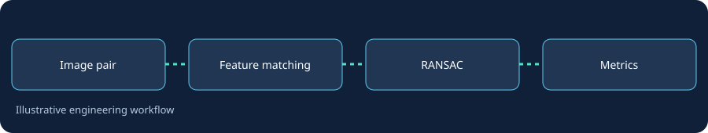
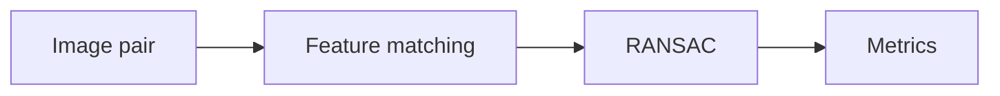
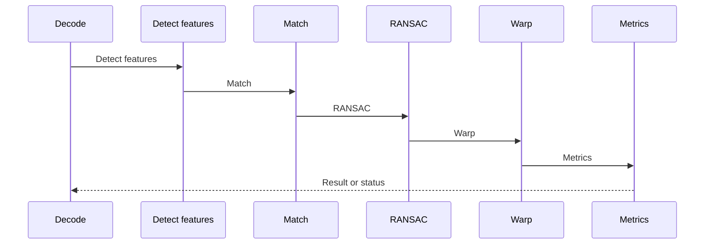
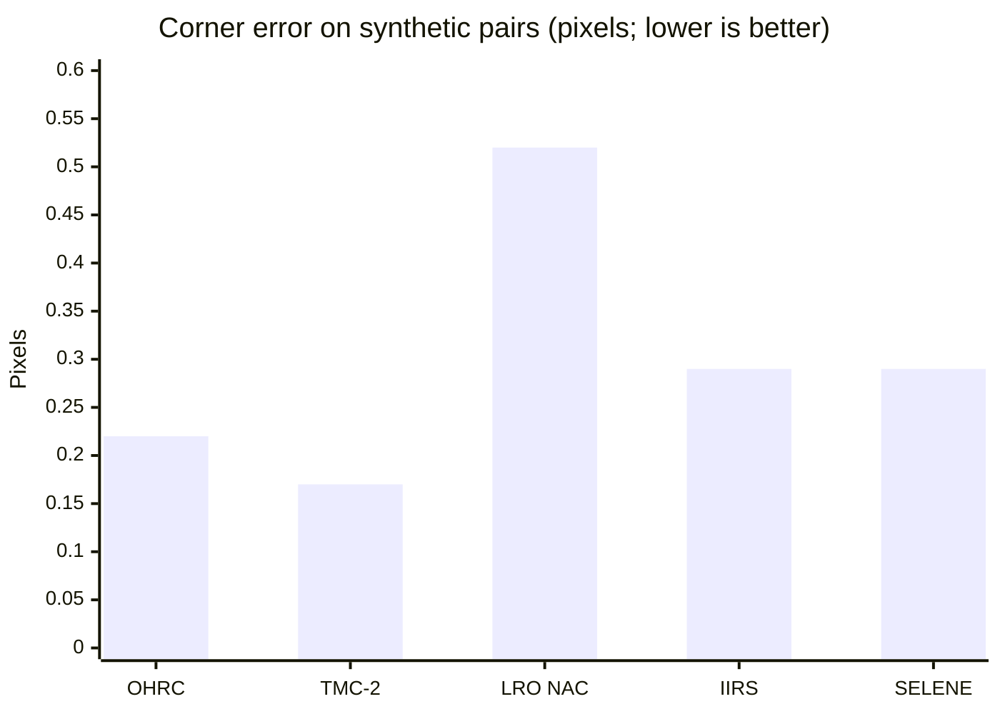

# LunarReg Workbench 🌕

<!-- portfolio-visual-start -->
## Engineering overview

 





Illustrative workflow: Image pair → Feature matching → RANSAC → Metrics. Not live telemetry or proof of production integration.

[Developer profile](https://github.com/ABHILASH9519) · [Issues](https://github.com/ABHILASH9519/lunarreg-workbench/issues)
<!-- portfolio-visual-end -->


Lunar image registration and correspondence analysis: a **Go** service (engine, REST/SSE API,
job queue, persistence, SVG charts) with an embedded web UI and a **Python** tooling layer
(dataset generator, benchmarks, CLI, reports).

```bash
make run                      # builds and serves http://localhost:8080
make test                     # go vet + go test + Python e2e tests (needs numpy)
docker build -t lunarreg . && docker run -p 8080:8080 -v lunarreg-data:/data lunarreg
```

## What it does

- **Engine (`internal/cv`, Go stdlib only):** PNG / JPEG / TIFF-GeoTIFF decoding (8/16/32-bit, strips,
  none / Deflate / PackBits), median denoise + CLAHE, Gaussian pyramid, multi-octave FAST-9 + Harris
  features with oriented 256-bit BRIEF, Hamming matching (ratio test + mutual cross-check), spatial-grid
  filtering, RANSAC with local optimisation for **similarity / affine / homography**, automatic model
  recommendation (Occam preference), warping, and RMSE / median / coverage / hull / NCC / mutual-information metrics.
- **Server:** worker-pool job queue, live progress over Server-Sent Events, cancel, re-run, parameter sweep,
  per-visitor job history on disk (cookie-scoped), ZIP / CSV / JSON export, stats and Go-rendered SVG charts.
- **UI:** Mission Control dashboard, 2-step registration wizard (samples or drag-and-drop upload, presets),
  live pipeline tracker, viewer with zoom/pan, swipe compare, overlay / difference / checkerboard / matches
  and interactive correspondence points, history with search/filter/sort, Experiment Lab, Technology page.
- **Python (`tools/`):** `lunarreg.py` CLI, `benchmark.py`, `illumination_study.py`, `analyze.py`
  (batch + grid search), `loadtest.py`, `make_dataset.py` (PNG / 16-bit TIFF with exact ground truth), `report.py`.

## Measured results

All on **synthetic sample data** with exact ground truth (never mission imagery). Corner error is recomputed
independently in Python by `tools/benchmark.py`.

| Pair | Truth model | Recovered | Corner error |
|---|---|---|---|
| OHRC crater field | similarity | similarity | 0.22 px |
| TMC-2 sheared mosaic | affine | affine | 0.17 px |
| LRO NAC off-nadir | homography | homography | 0.52 px |
| IIRS low-sun | similarity | similarity | 0.29 px |
| SELENE noisy | similarity | similarity | 0.29 px |

Throughput (`tools/loadtest.py`, 12 jobs, 6 concurrent visitors, 2 workers): 12/12 completed, ~0.6 s compute
per 512 px pair, median end-to-end 1.9 s.

## Known limitations (measured, not hidden)

Accuracy degrades as the sun-azimuth difference between images grows. The pipeline first uses binary
oriented-BRIEF descriptors and, when consensus is weak, automatically retries with a contrast-reversal-invariant
gradient descriptor (`descriptor: auto`; force one with `brief` or `gradient`). `tools/illumination_study.py`
(3 seeds per setting, success = corner error ≤ 3 px):

| Δ sun azimuth | 0° | 10° | 20° | 30° | 40° | 60° |
|---|---|---|---|---|---|---|
| BRIEF only | 100% | 100% | 100% | 67% | 33% | 0% |
| auto (with gradient fallback) | 100% | 100% | 100% | 100% | 33% | 0% |

Beyond ~30° the engine is unreliable (few inliers at 30°, mostly failures at 40°+).
Failures are reported as failures (no fabricated metrics; uncomputed values show N/A).
Other limits: tiled / LZW TIFFs are rejected with an explicit error; metrics are processed-pixel diagnostics, not
validation on sourced mission imagery; the data store is a local directory, not a database.

## Layout & language split

Go: `cmd/`, `internal/{cv,synth,store,server,charts}` (~3.7k lines incl. tests). Python: `tools/`, `tests/`
(~0.8k lines). Measured on logic code that is **≈82% Go / 18% Python**. The browser client
(`web/`: JS, CSS, HTML — browsers require them) is separate and is about a third of the repository by bytes;
computation, rendering of charts, persistence and the API are all Go.

## Deployment

The production web service is deployed as one Docker-based Go process on Render:
[https://lunarreg-workbench.onrender.com](https://lunarreg-workbench.onrender.com).
The Go server serves both the embedded Mission Control UI and the `/api/*` endpoints,
so the browser uses same-origin requests and does not need a separate frontend deployment.

The Render blueprint (`render.yaml`) tracks `main`, builds from `Dockerfile`, and
uses `/api/health` as its health check. Deploys are triggered automatically after
changes reach `main`.

**Storage note:** the current blueprint uses Render's free plan and does not provision
a persistent disk. The service writes job data under `/data`, but files on an ephemeral
filesystem can be lost when the instance is replaced or restarted. Use a persistent
disk mounted at `/data` (or move the store to durable object/database storage) before
relying on the hosted instance for long-term job history. A persistent disk may incur
additional hosting charges; it is intentionally not provisioned by this repository.

## API

`GET /api/health | /samples | /stats | /defaults | /benchmark | /study | /charts/{rmse|models|confidence}.svg`
`POST /api/jobs` (multipart: `sample=<id>` or `source`+`reference` files, optional `params` JSON; see `GET /api/defaults`)
`GET /api/jobs[/{id}]`, `/events` (SSE), `/image/{registered|overlay|difference|checker|matches|before|source|reference}`,
`/export.zip`, `/correspondences.csv`, `/result.json` · `POST /api/jobs/{id}/rerun|cancel|sweep` · `DELETE /api/jobs/{id}`

## Input safety and verification

Image dimensions are checked before raster allocation. The decoder rejects images above
64 megapixels, and the strip-based TIFF path also caps decoded raster memory at 256 MiB.
The upload API separately limits each uploaded file to 20 MiB.

The CI workflow runs formatting, vet, build, unit/integration tests, Python end-to-end
tests, and the Go race detector. For local checks:

```bash
make test-race
make coverage
make fuzz-decode
```

The decoder fuzz target accepts arbitrary byte streams and is intended to catch panics
or unsafe behavior at the untrusted image boundary.


## Technical walkthrough



This sequence is a conceptual review aid, not a recorded execution trace. Consult the implementation and existing run instructions for supported behavior.

 

### Synthetic registration benchmark



Values are from the documented synthetic benchmark, not mission imagery or a new test run.
